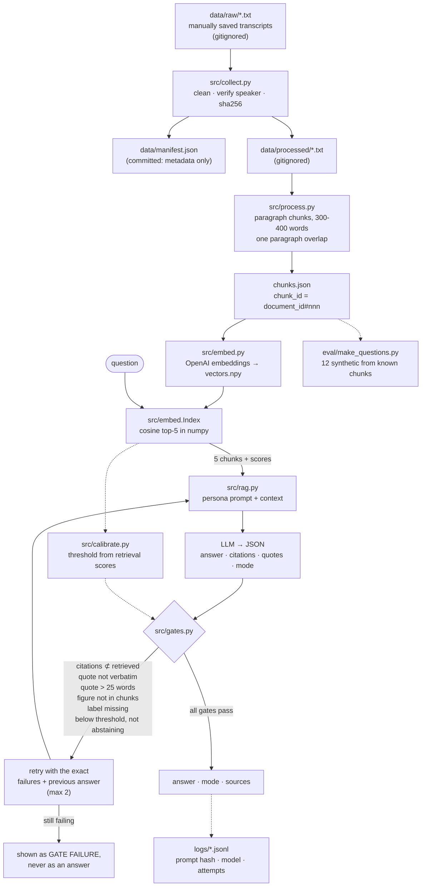

# What Would Lee Kuan Yew Do?

A small retrieval-augmented chatbot that answers questions from a corpus of
archived Lee Kuan Yew speeches, and refuses to answer when the corpus cannot
support one.

> **This is an AI simulation based on archived speeches. It is not Lee Kuan Yew.**
> It has no memory, no views of its own, and no knowledge beyond the passages
> retrieved for each question. Every answer it gives is machine-generated text
> conditioned on archive excerpts. Lee Kuan Yew died in March 2015 and has no
> opinion about anything after that date.

The interesting part of this project is not that it answers. It is what it does
when it cannot: every quote is checked character-for-character against the
passage it claims to come from, every figure is checked against the retrieved
text, and an answer that fails is not shown.

---

## How it works



### The gates

The model proposes, the gates dispose. All five are pure functions in
[src/gates.py](src/gates.py) and are tested with no API key:

| Gate | Rule |
|---|---|
| Citation subset | every cited `chunk_id` must be in the retrieved set |
| Quote grounding | every quote must be a verbatim span of the chunk it names, whitespace and smart-punctuation normalised, **25 words or fewer** |
| Number grounding | every figure and year in the answer must appear in the retrieved chunks, unless the mode is `extrapolation` |
| Extrapolation label | mode `extrapolation` requires the exact sentence *"Hypothetical extrapolation, not something he said."*, and no other mode may carry it |
| Abstention | if the best similarity is below the calibrated threshold, the mode must be `abstain` |

On failure the exact failure list and the model's own previous answer are sent
back to it, at most twice. An answer that never passes is reported as a gate
failure.

### Three modes

- `documented` — the retrieved speeches support the answer, with citations and quotes.
- `extrapolation` — the speeches establish a relevant principle but not the answer;
  carries the mandatory label.
- `abstain` — the archive does not cover it. No consolation answer in his voice.

---

## Stack, and what is deliberately absent

Python 3.11+, `openai`, `numpy`, `pydantic`, `pytest`, `PyYAML`, `python-dotenv`.

**No LangChain, no Chroma, no sentence-transformers, no RAGAS.** The corpus is a
few hundred chunks. The entire index is one float32 matrix, retrieval is a single
matrix-vector product, and the whole thing fits in a few hundred kilobytes of RAM.
A vector database would add a service, a schema and an install to a problem that
does not have them. RAGAS is absent for a different reason: every metric in this
project is deterministic, because an evaluation scored by an LLM is exactly as
fallible as the thing it is evaluating, and it is not reproducible.

Model names are read from `.env` (`OPENAI_MODEL`, `EMBED_MODEL`) and are not
hardcoded anywhere in `src/`.

---

## Data provenance

**Source: speeches only, from the National Archives of Singapore, Archives Online.**

No memoirs and no books. They are copyrighted works that cannot be redistributed,
and their contents are not in this corpus. If you ask this chatbot something that
only a memoir would answer, the honest response is an abstention, and
`eval/adversarial.json` tests exactly that.

### The corpus is not in this repository, on purpose

The National Archives of Singapore FAQ states that unauthorised reproduction of
Archives Online records is a copyright violation. So:

- `data/raw/` and `data/processed/` are gitignored and are **never committed**.
- `*.npy` embedding vectors are gitignored.
- What *is* committed is [`data/manifest.json`](data/manifest.json): for each
  speech, its `document_id`, title, date, `source_url`, `retrieved_at`, word
  count, `sha256` of the cleaned text, and chunk count. Enough to verify and
  rebuild the corpus, not enough to reconstruct it.
- Quotes anywhere in this repository — sample conversations, eval output — are
  **25 words or fewer and attributed to a document and date**.

### Collection was manual, and here is why

`nas.gov.sg` sits behind AWS WAF Bot Control. Every scripted request, including
the request for `robots.txt` itself, returns an empty `HTTP 202` carrying
`x-amzn-waf-action: challenge`:

```
HTTP/2 202
server: CloudFront
content-length: 0
x-amzn-waf-action: challenge
```

Because `robots.txt` cannot be read, the site's crawl policy is unknowable.
Fetching anyway, while defeating an explicit bot challenge, was not acceptable
for this project, so **nothing here crawls the archive**. No browser user-agent
spoofing, no headless-browser challenge solving. The full evidence, with the
URLs tried and the timestamps, is in
[`docs/collection-blocked.md`](docs/collection-blocked.md).

Instead a human opens each record in a normal browser and saves the transcript to
`data/raw/<document_id>.txt`. `src/collect.py` then verifies what was saved — it
is an ingest-and-verify step, not a crawler. It refuses to build a manifest if any
entry has an unfilled field, a duplicate id, a `source_url` off `nas.gov.sg`, a
missing file, fewer than 300 words, or a transcript whose opening does not
corroborate that the speaker is Lee Kuan Yew.

### Rebuilding the corpus from this repo

1. Open each `source_url` in [`data/manifest.json`](data/manifest.json) in a browser.
2. Save each transcript to `data/raw/<document_id>.txt`, keeping the archive's own
   header line at the top.
3. Copy the metadata into [`config/sources.yaml`](config/sources.yaml).
4. `make collect` — and compare the `sha256` it reports against the manifest's. A
   mismatch means your text differs from the one these results were produced on.

---

## Running it

```bash
cp .env.example .env     # then add OPENAI_API_KEY, OPENAI_MODEL, EMBED_MODEL
make install
make test                # 29 gate tests, no API key needed

# with a corpus in data/raw/ and config/sources.yaml filled in:
make collect             # verify + manifest
make process             # chunk
make embed               # vectors.npy
make questions           # 12 synthetic eval questions
make calibrate           # abstention threshold, from retrieval scores
make eval                # the real run -> eval/results.md

make chat                # interactive
./.venv/bin/python app/chat.py "What did you believe education was for?"
```

`make check` is a pre-commit guard: it fails if corpus text, vectors or `.env`
are staged, or if a key-shaped string appears in the staged diff.

---

## Eval results

See **[eval/results.md](eval/results.md)**, generated by `eval/run_eval.py` from
one real run. It is not written unless the run completes.

24 questions: 12 synthetic (written by the model from a known gold chunk, flagged
as such because they are easier by construction), 6 hand-written broad topic
questions with confirmed gold documents, and 6 unanswerable or adversarial —
an event after 2015, something only a memoir holds, personal trivia, a request to
fabricate a quote, a prompt injection, and a question outside politics entirely.

Deterministic metrics only: retrieval hit@5 against gold, citation validity,
quote grounding, correct abstention on the unanswerable set, correct labelling of
extrapolations, and first-attempt pass rate against pass-after-retry. No LLM
judge. The biases — small n, easier synthetic questions, and a threshold tuned on
the same set it is scored on — are stated in `eval/results.md` next to the numbers
they qualify.

---

## What went wrong

Facts from the run logs.

1. **The archive could not be crawled at all.** The first real action of the
   project was a request for `nas.gov.sg/robots.txt`, and it came back empty with
   `x-amzn-waf-action: challenge`. Every subsequent URL did the same. This
   invalidated the planned `collect.py` entirely and the script was rewritten as
   an ingest-and-verify step over manually saved files. Evidence:
   [`docs/collection-blocked.md`](docs/collection-blocked.md).

*(Further entries are added from `logs/` and `eval/results.json` after the eval run.)*

---

## Limitations

- **No memoirs, no books.** Speeches only. Anything he wrote rather than said is
  outside this system, and questions about it are abstentions by design.
- **The corpus is not redistributed.** Copyright. You can verify it by hash and
  rebuild it from the manifest, but you cannot download it from here.
- **12–15 speeches.** A few hundred chunks against a man who spoke publicly for
  more than fifty years. Whole decades, audiences and topics are absent, and the
  system cannot tell you that something is missing — only that it did not retrieve it.
- **English only.** He spoke in Malay and Hokkien too. None of that is here.
- **Persona fidelity is not measured.** Nothing in the eval tests whether the
  voice actually resembles his. The gates check that quotes are real; they say
  nothing about whether the prose around them sounds like the man.
- **The eval is small and partly synthetic.** n=24, half of it written by the same
  model family being tested, from the passages it is then asked to retrieve.
- **The abstention threshold is tuned on the eval set.** There was no honest way
  to hold out a split at this n, so the abstention numbers are optimistic.
- **Retrieval is the ceiling.** The gates can only verify against what was
  retrieved. If the right passage is not in the top 5, a confident, fully
  "grounded", correctly cited and completely unhelpful answer is still possible.

---

## What I would change

- **Hold out a calibration split.** The threshold being tuned on the eval set is
  the weakest claim in this repo. Fixing it needs roughly 60–100 questions, which
  needs a bigger corpus first.
- **Measure persona fidelity properly**, with a human rubric on a blind mix of
  real excerpts and generated answers. It is the one quality claim here with no
  evidence behind it.
- **Retrieve more than one way.** Pure dense cosine misses exact terms — a
  statute name, a year, a place. BM25 alongside the embeddings, fused, would
  likely move the hand-written hit@5 more than any prompt change.
- **Write the hand-written eval questions before looking at the corpus**, to stop
  the test set drifting towards what the corpus happens to contain.
- **Ask the Archives for permission** rather than working around the absence of
  it. A licensed corpus would make the whole data-provenance section shorter and
  the project reproducible by anyone.

---

## Repository layout

```
config/sources.yaml     speech metadata you fill in; collect.py validates it
config/threshold.json   calibrated abstention threshold (written by src/calibrate.py)
data/manifest.json      committed provenance: ids, urls, dates, hashes, chunk counts
prompts/persona.md      the persona prompt, with a version history block
src/collect.py          ingest + verify (NOT a crawler)
src/process.py          paragraph chunking with overlap
src/embed.py            embeddings + the numpy cosine index
src/rag.py              retrieve → generate → gate → retry
src/gates.py            the five deterministic gates
src/calibrate.py        threshold from retrieval scores on the eval set
src/textutil.py         normalisation, quote grounding, number grounding
app/chat.py             CLI chat with sources and run logging
eval/                   questions, the runner, and results from real runs
tests/                  gate tests, runnable with no API key
docs/                   sample conversations from real runs
logs/                   run logs with prompt hashes and model names
```
