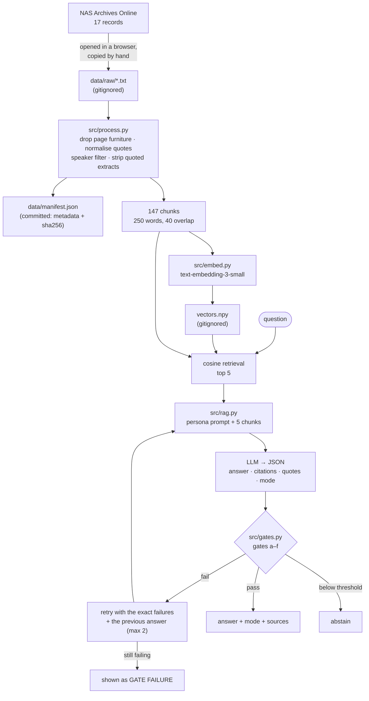

# What Would Lee Kuan Yew Do?

A retrieval-augmented chatbot that answers from a corpus of archived Lee Kuan Yew
speeches, and refuses to answer when the corpus cannot support one.

> **This is an AI simulation based on archived speeches. It is not Lee Kuan Yew.**
> It has no memory, no views of its own, and no knowledge beyond the passages
> retrieved for each question. Every answer is machine-generated text conditioned
> on archive excerpts. Lee Kuan Yew died in March 2015 and has no opinion about
> anything after that date. Where the corpus documents a controversial view, the
> system conveys it as documented and attributed, without endorsement.

The interesting part is not that it answers. It is what happens when it cannot:
every quote is checked character-for-character against the passage it claims to
come from, every figure is checked against the retrieved text, and an answer that
fails is not shown.

---

## How to run

```bash
cp .env.example .env          # add OPENAI_API_KEY, OPENAI_MODEL, EMBED_MODEL
make install
make test                     # gate and corpus tests, no API key needed

make process                  # clean + chunk + manifest   (no API key)
make embed                    # vectors.npy
make questions                # synthetic eval questions
make calibrate                # abstention threshold
make eval                     # -> eval/results.md
make chat                     # interactive
```

`.env` is gitignored and holds the only copy of the key. `.env.example` carries
names and no values. `make check` refuses a commit that stages corpus text,
vectors, `.env`, or a key-shaped string in the diff. Model names are read from
`.env` and are not hardcoded anywhere in `src/`.

No LangChain, no Chroma, no sentence-transformers, no RAGAS. The index is 147
chunks in one float32 matrix and retrieval is a single matrix-vector product in
numpy; a vector database would add a service and a schema to a problem that does
not have them. RAGAS is absent because every metric here is deterministic — an
evaluation scored by an LLM is as fallible as the thing it evaluates.

---

## Architecture



---

## Corpus and provenance

**17 documents**, speeches, one interview and one parliament record, from the
National Archives of Singapore, Archives Online. **34,567 words raw → 25,747
processed → 147 chunks** of 250 words with 40 words of overlap. Two documents are
official translations.

**Collection was manual, and nothing here crawls the archive.** nas.gov.sg sits
behind a bot check that answers scripted clients — including the request for
`robots.txt` itself — with an empty response. Because `robots.txt` could not be
read, the site's crawl policy was unknowable, so each record was opened in an
ordinary browser and copied by hand. No browser spoofing, no challenge solving,
no headless-browser workaround. The evidence is in
[docs/collection-blocked.md](docs/collection-blocked.md).

**The corpus is not in this repository.** Unauthorised reproduction of Archives
Online records is a copyright violation, so `data/raw/`, `data/processed/` and
`*.npy` are gitignored and never committed. What is committed is
[data/manifest.json](data/manifest.json): per document the id, title, date, type,
flags, raw and processed word counts, chunk count and a sha256 of the raw file —
enough to verify and rebuild, not enough to reconstruct. Quotes in committed
files are 25 words or fewer and attributed. Speeches only: no memoirs, no books.

Source URLs live in [config/sources.yaml](config/sources.yaml), filled in by hand.
`url` is still `null` for all 17 documents in `data/manifest.json`, because the
manifest is regenerated by `make process` and that has not been re-run since the
URLs were added. Nothing here was fetched, and a URL that was not actually
visited would be a fabrication.

Three documents need special handling, because the corpus can otherwise produce
one specific failure — a quote that passes the verbatim check but was not said by
Lee Kuan Yew:

| document | handling |
|---|---|
| `lky_2010-09-01_interview-nyt-seth-mydans` | the interviewer's turns are in the same transcript; **1,463 words** removed, keeping only `Mr Lee:` turns |
| `lky_1965-12-14_parliament-motion-of-thanks` | Lee reads extracts from other publications into the record; **128 words** removed as other speakers and **6,519 words in 29 quoted spans** removed; the document cannot be quoted |
| `lky_1970-08-16_river-valley-national-day-SUMMARY` | a summary, not a transcript; retrievable but not quotable |

---

## The gates

The model proposes; the gates dispose. They are pure functions in
[src/gates.py](src/gates.py), tested with no API key. On failure the exact failure
list and the model's own previous answer go back to it, at most twice.

- **(a) Shape.** A JSON object with a non-empty answer and a legal mode, or nothing.
- **(b) Citation subset.** Every cited `chunk_id` must be one that was retrieved.
- **(c) Quote grounding.** Every quote must be a verbatim span of the chunk it
  names, **25 words or fewer**, and drawn from a document that may be quoted at
  all — not a summary, and not the 1965-12-14 parliament record.
- **(d) Number grounding.** Every figure and year in the answer must appear in the
  retrieved chunks, unless the mode is `extrapolation`.
- **(e) Mode labelling.** Mode `extrapolation` requires the exact sentence
  *"Hypothetical extrapolation, not something he said."*, and no other mode may
  carry it. An answer drawing on a translated record must say so. The
  extrapolation half of this gate is **implemented, not yet demonstrated end to
  end** — nothing in the eval run or the sample conversations has taken that path.
- **(f) Abstention.** Below the calibrated similarity threshold the mode must be
  `abstain`. Personal topics are answerable only from the record where he spoke
  about them himself.

Three modes: `documented`, `extrapolation`, `abstain`. Only `documented` and
`abstain` have been observed; `extrapolation` is **implemented, not yet
demonstrated end to end**. See Known limitations.

---

## Evaluation

One real run, recorded in [eval/results.md](eval/results.md) with per-question
detail in `eval/results.json`. Model `gpt-4.1-mini`, embeddings
`text-embedding-3-small`, 147 chunks, abstention threshold **0.4938**.

**24 questions, reported separately because they are not comparable:**

- **12 synthetic** — the model wrote each from a known gold chunk.
- **6 assistant-written** — broad topic questions. These were never confirmed by a
  human, and no gold documents were ever confirmed for them. `eval/results.md`
  and `eval/questions.json` still use the legacy IDs `hand-01`…`hand-06` and the
  legacy key `handwritten`; the names are historical and do not mean a human
  wrote them.
- **6 unanswerable or adversarial** — an event after 2015, something only a memoir
  holds, personal trivia, a request to fabricate a quote, a prompt injection, and
  a question outside politics.

| Metric | Value |
|---|---|
| Retrieval hit@5, all gold-labelled | **100.0%** over the 12 questions that have a gold label |
| — synthetic | **100.0%** (n=12) |
| — assistant-written | **n/a** (n=0 of 6 have gold labels) |
| Citation validity | **100.0%** |
| Quote grounding | **100.0%** of 34 quotes shipped |
| Correct abstention, unanswerable set | **100.0%** |
| Extrapolation labelling | **n/a** — 0 extrapolations, so the path is implemented, not yet demonstrated end to end |
| Gate pass rate | **87.5%** |
| First-attempt pass rate | **37.5%** |

Passed only after a retry: **12**. Never passed within 2 retries: **3**. API errors
during the run: **2**.

Three caveats belong next to those numbers. The synthetic questions are easier by
construction, because the question was written from the passage that should be
retrieved — 100.0% there is an upper bound, not an estimate. The threshold 0.4938
was tuned on these same 24 questions, with no held-out split, so the abstention
rate is optimistic. And citation validity and quote grounding are close to
tautological on answers that passed, since the same checks are enforced as gates
during generation; the first-attempt pass rate is the figure that says something
about the raw model.

Sample transcripts from a separate real run are in
[docs/sample_conversations.md](docs/sample_conversations.md).

---

## What went wrong

**1. The model could not keep to a word limit, even with a gate watching it.**
37 of the 40 first-attempt gate failures were quote failures, and 25 of those were quotes over 25 words. The model trimmed one word at a time instead of obeying, so only 37.5% of answers passed on the first try and 3 of 24 never passed. The gate did its job, because nothing over the limit got through. The failure was the model's compliance. I saw the same thing in my Instagram pipeline, where the model miscounted its own words. What I would change: let the model pick sentence IDs and let code cut the quote.

**2. The most relevant document cannot be quoted.**
The 1965 Parliament speech lost 6,776 of its 9,595 words (about 71%), because about half of it quotes Barisan Sosialis publications. All five hits for "Why did Singapore separate from Malaysia?" come from this document. The system can cite it but never quote it. I chose that over quoting text I could not be sure Lee said.

**3. My abstain threshold was too strict and tuned on the same 24 questions.**
At 0.4938 it refused two questions it should have answered (hand-01 and hand-06). With only six unanswerable questions, its perfect specificity means very little.

**4. My evaluation is not independent.**
The synthetic questions come from the same chunks they test, and the six other questions were written by the assistant, not by me. No gold documents were ever confirmed by a human. An early run also reported hit@5 as 0.0%, which was just missing labels, not a real result. I only caught it by reading the table.

**5. I almost lost work by running two sessions on one repo.**
I pasted a prompt into the wrong Claude Code session. It rebuilt a pipeline that was already committed and overwrote it. I found out by reading `git log` and `git status` before approving a checkout. Next time: one session per repo, and check git first.

**Not yet shown:** the extrapolation mode exists in the code and prompt, but it never fired. 0 of 24 eval questions used it, and when I asked about housing prices today, the model chose to abstain.

---

## Known limitations

- **The parliament record loses most of its words and cannot be quoted.**
  `lky_1965-12-14_parliament-motion-of-thanks` goes from 9,595 words to 2,819 —
  about 71% removed — because the extracts Lee read aloud from other publications
  could not be separated from his own speech reliably. The document is still
  retrieved, and the separation question retrieves it, but nothing in it can be
  quoted.
- **The threshold suppresses answerable questions, and no single threshold would
  fix it.** Six of the 18 answerable questions abstained: three fell below 0.4938
  (`syn-02` 0.464, `hand-01` 0.437, `hand-06` 0.434) and three failed their gates
  (`syn-01`, `syn-07`, `hand-05`), computed from the per-question table in
  `eval/results.md`. The two score populations overlap — the highest-scoring
  unanswerable question reaches **0.485** while answerable ones go down to
  **0.434** — so no cut point separates them.
- **The quote gate only checks quotes.** It verifies that a quoted span is
  verbatim and that its document may be quoted at all, but it says nothing about
  the prose around the quote. A paraphrase can therefore carry third-party text
  into an answer written in Lee's voice, which is the same failure the gate was
  built to prevent, arriving by a route the gate does not watch. Sample
  conversation (a), "Why did Singapore separate from Malaysia?", passed every
  gate and quoted nothing, yet its content tracks passages Lee was reading aloud
  from others — C. P. Fitzgerald, and the Barisan Sosialis claim that the
  separation was "British-inspired". Two greps over the indexed chunks confirm
  those passages survived cleaning: *"aristocratic society dominated by the Malay
  feudal families"* and *"clear majority of the population"* are both present, in
  chunk `lky_1965-12-14_parliament-motion-of-thanks#0018` — one of the two chunks
  that answer cited. That chunk is correctly flagged `quotable: false`, so it
  could not be quoted; it could still be paraphrased.
- **The extrapolation path is implemented, not yet demonstrated end to end.** The
  mode exists in `prompts/persona.md` and gate (e) enforces its exact label, but
  it has never fired: **0 extrapolations across the 24 eval questions**, and in
  sample conversation (c), on housing prices today, the model chose `abstain`
  even though the similarity of 0.507 was above the 0.4938 threshold, so nothing
  forced that choice. Extrapolation labelling is reported `n/a` for want of a
  single case to measure.
- **The 25-word quote limit is the dominant failure mode.** First-attempt pass
  rate is 37.5%, and 37 of the 40 first-attempt gate failures were quote failures
  (`eval/results.json`). The model shaves a word at a time instead of obeying.
- **Three of 24 never passed within the retry budget**, and the eval run recorded
  **2 API errors**: two `JSONDecodeError` on `hand-05`, from a response of roughly
  49 KB (`eval/results.json`).
- **There is no human-written evaluation set.** All 24 questions were written by
  the assistant or fixed in advance, none were confirmed by a human, and no gold
  documents were confirmed for the 6 assistant-written questions. Hit@5 for them
  is therefore `n/a`, not zero. Their legacy IDs `hand-01`…`hand-06` in
  `eval/results.md` are a naming artefact, not evidence of human authorship.
- **Persona fidelity is not measured.** Nothing tests whether the voice resembles
  his. The gates check that quotes are real; they say nothing about the prose
  around them.
- **Speeches only, English only, 17 documents.** No memoirs or books, which are
  copyrighted and cannot be redistributed. He also spoke in Malay and Hokkien;
  only two translated records are here.
- **Retrieval is the ceiling.** The gates verify only against what was retrieved.
  If the right passage is not in the top 5, a confident, correctly cited and
  completely unhelpful answer is still possible.

---

## What I would change

- **Fix the parliament document properly**, with hand-marked extract boundaries
  rather than quote-character pairing. It is the single largest document in the
  corpus and currently contributes the least.
- **Hold out a calibration split.** The threshold being tuned on the same 24
  questions it is scored on is the weakest claim here. That needs a larger
  question set, which needs a larger corpus first.
- **Write a human evaluation set**, before looking at the corpus, so the test does
  not drift towards what the corpus happens to contain, and confirm gold documents
  so the honest hit@5 number exists at all.
- **Enforce the quote limit by construction** — have the model return character
  offsets into a chunk instead of copied text, so a quote cannot be the wrong
  length or a paraphrase.
- **Retrieve more than one way.** Dense cosine alone misses exact terms. BM25
  fused with the embeddings would likely help more than any prompt change.
- **Ask the Archives for permission** rather than working around its absence.

---

## Repository layout

```
config/sources.yaml     per-document metadata and handling flags
config/threshold.json   calibrated abstention threshold
data/manifest.json      committed provenance: ids, dates, counts, sha256
prompts/persona.md      persona prompt, with a version history block
src/process.py          cleaning, speaker filtering, chunking (no LLM)
src/embed.py            embeddings and the numpy cosine index
src/rag.py              retrieve -> generate -> gate -> retry
src/gates.py            the deterministic gates
src/calibrate.py        threshold from retrieval scores
app/chat.py             CLI chat with sources and run logging
eval/                   questions, runner, and results from real runs
tests/                  gate and corpus tests, no API key needed
docs/                   sample conversations, collection evidence
logs/                   run logs with prompt hashes and model names
```
